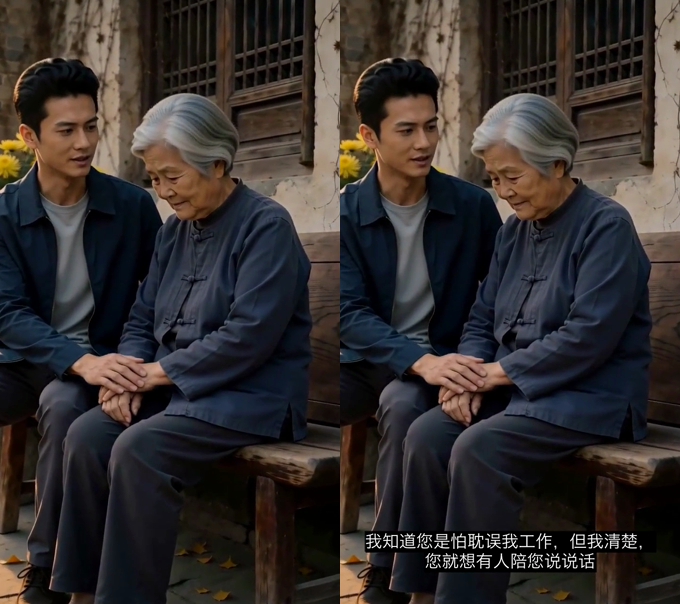

# video-subtitle

[](https://github.com/kaylon-he/video-subtitle-skill/actions/workflows/ci.yml)
[](LICENSE)

给视频自动加字幕，并把字幕**烧进画面**，输出「带字幕 MP4 + SRT」。
`whisper.cpp` 负责识别、`FFmpeg + libass` 负责排版与烧录，全部在本机跑，不用上传视频、不要 API key。

- 中文识别用 `large-v3` 模型，Apple Silicon 走 Metal 加速（33 秒音频约 20 秒转完）
- 长句按「画面宽度 / 字号」自动断行，优先断在标点之后
- 底部居中白字 + 半透明黑底框，样式接近主流短视频字幕
- 自动挑选系统里真实存在的中文字体，避免渲染成方框



*左：原片 ｜ 右：本工具输出 —— 长句自动断行、底部居中、半透明底框*

示例成片：[Release v0.1.0](https://github.com/kaylon-he/video-subtitle-skill/releases/download/v0.1.0/demo-subtitled.mp4)

## English

Generate subtitles for a video and **burn them into the picture** — one command, fully offline, no API key, no Python ML stack.

Pipeline: `ffmpeg` extracts a 16 kHz mono track → `whisper.cpp` (Whisper `large-v3` ggml, Metal-accelerated on Apple Silicon) transcribes it to SRT → a dependency-free script converts SRT to ASS with width-aware line breaking and CJK font selection → a libass-enabled `ffmpeg` burns the ASS back into the frame and copies the audio stream.

- **Burn-in / hard subtitles**, not a separate `.srt` track — works on any player, any social platform
- **Whisper.cpp instead of openai-whisper** — no `torch`, no model download via OpenAI CDN (that path fails its own SHA256 check often); a 33 s clip transcribes in ~20 s on M-series
- **Auto line wrapping** — long sentences are wrapped at punctuation using the video width and font size, so nothing gets clipped at the frame edges
- **Real font probing** — picks a CJK font that actually exists on the system, so text never renders as tofu boxes
- **Environment-checked** — refuses to run with a stripped `ffmpeg` build that lacks libass, which is the single most common failure mode
- Also usable as an **agent skill** (see the bottom section)

Keywords: video subtitle generator, auto captions, burned-in subtitles, whisper.cpp, ffmpeg libass, whisper large-v3, offline, on-device, macOS, Chinese ASR, agent skill.

一句话：本机一条命令，视频进、带字幕成片出。

## 安装

```bash
# 1) 语音识别引擎
brew install whisper-cpp

# 2) 带 libass 的 ffmpeg（二选一）
brew install ffmpeg-full          # 依赖较多，但版本新
# 或静态构建（约 21MB，解压后是单文件，Apple Silicon）
curl -L -o ffmpeg-arm.zip https://www.osxexperts.net/ffmpeg71arm.zip
unzip -o ffmpeg-arm.zip && mkdir -p ~/.local/bin && mv ffmpeg ~/.local/bin/ffmpeg-libass

# 3) 模型：下载 ggml-large-v3.bin 后放到 ~/.cache/whisper/
```

确认 ffmpeg 可用（必须打印出 `subtitles`）：

```bash
~/.local/bin/ffmpeg-libass -hide_banner -filters | awk '{print $2}' | grep -x subtitles
```

## 用法

```bash
bash scripts/add_subtitles.sh input.mp4 -o output.mp4 -l zh
```

| 参数 | 说明 |
| --- | --- |
| `-l, --language` | 源语言，默认 `zh`，可传 `auto` |
| `-f, --fontsize` | 字号，默认 42 |
| `-s, --srt-only` | 只出 SRT，不烧录（用来先校对错字） |
| `-o, --output` | 输出路径，默认 `<原文件名>_subtitled.mp4` |

脚本会把转录结果打印到终端，**先看一遍再交付**：人名、地名、成语经常被识别错（实测「重阳姐」→「重阳节」、「久久重扬」→「九九重阳」）。改好 SRT 后再烧录。

成品建议抽 2–3 帧验证字幕没有被裁切：

```bash
ffmpeg -ss 5 -i output.mp4 -frames:v 1 check.png
```

## 用到的库与工具

| 组件 | 来源 / 安装方式 | 在本流程中的作用 |
| --- | --- | --- |
| **FFmpeg**（含 `libass`） | `brew install ffmpeg-full`；或静态构建（见上） | 抽音轨、取分辨率、最终烧录与重编码 |
| **libass** | FFmpeg 的 `subtitles` / `ass` 滤镜依赖 | 解析并渲染 ASS 字幕（断行后的排版、底框、字体匹配） |
| **libfreetype** | FFmpeg 编译依赖（`--enable-libfreetype`） | 字形光栅化，把文字画成像素 |
| **fontconfig** | FFmpeg 编译依赖（`--enable-fontconfig`） | 按字体名在系统里查找中文字体；找不到会渲染成方框 |
| **whisper.cpp**（`whisper-cli`） | `brew install whisper-cpp` | 语音识别，输出 SRT；Apple Silicon 走 Metal 加速 |
| **OpenAI Whisper large-v3 权重**（`ggml-large-v3.bin`） | whisper.cpp 官方模型仓库 | 中文识别精度最高的一档模型 |
| **libx264** | FFmpeg 内置编码器 | 烧字幕后重新编码 H.264 |
| **AAC** | FFmpeg 内置编码器（本流程用 `-c:a copy`） | 音轨直接复制，不重新编码 |
| **Python 3**（仅标准库） | 系统自带 | `scripts/srt_to_ass.py`：SRT → ASS，自动断行 + 选字体 |
| **系统字体 Hiragino Sans GB / PingFang SC / STHeiti** | macOS 自带 | ASS 字幕的字体来源，脚本会自动挑选存在的那一个 |

## 没有用哪些（以及为什么）

- **openai-whisper / torch**：模型体积和依赖都大，且需从 OpenAI CDN 下载权重（实测 461MB 的 `small` 下载后 **SHA256 校验失败**）。
- **auto-subtitle（m1guelpf）**：能力等价（Whisper + ffmpeg 烧录），但同样依赖 `openai-whisper` + `ffmpeg-python`，必须先下载模型才能用。本流程用本机已装的 whisper.cpp 达到同样效果，速度快得多。
- **Homebrew 的精简 `ffmpeg`**：该构建**不含 libass**，`subtitles` / `ass` / `drawtext` 滤镜全部缺失，无法烧字幕。这是最容易踩的坑。

## 脚本搜索路径

`add_subtitles.sh` 按顺序查找，找到即用：

- ffmpeg：`$FFMPEG` → `~/.local/bin/ffmpeg-libass` → `which ffmpeg`（需带 libass）→ `/opt/homebrew/opt/ffmpeg-full/bin/ffmpeg` → `/opt/homebrew/bin/ffmpeg`
- whisper-cli：`$WHISPER_CLI` → `which whisper-cli` → `/opt/homebrew/bin/whisper-cli`
- 模型：`$WHISPER_MODEL` → `~/.cache/whisper/ggml-large-v3.bin` → `ggml-medium.bin` → `ggml-small.bin` → `~/.cache/whisper.cpp/ggml-large-v3.bin` → `/opt/homebrew/share/whisper.cpp/models/ggml-large-v3.bin`

## 常见问题

| 现象 | 原因 | 处理 |
| --- | --- | --- |
| 字幕是一串空方框（豆腐块） | fontconfig 没找到中文字体（例：macOS 上 `PingFang.ttc` 可能不在 `/System/Library/Fonts`） | 脚本已自动探测并回退到 Hiragino Sans GB / STHeiti；也可 `--font` 显式指定 |
| `No such filter: 'subtitles'` / `ass` | ffmpeg 构建缺 libass | 换 `ffmpeg-full` 或静态构建；用上面的检查命令确认 |
| 长句被画面左右裁掉 | ASS 自动换行失效 | 本流程用 `WrapStyle: 2` + 脚本按 `宽度/字号` 插 `\N`；仍溢出就调小 `-f` |
| 专有名词错字（人名、成语、节日名） | ASR 固有误差 | 先 `-s` 只出 SRT 人工校对，改好后把 SRT 交给 `srt_to_ass.py` 再烧录 |
| 模型 SHA256 不匹配 | 下载中断 | 用支持断点续传的 `curl -C -` 重下 |

## 作为 Agent Skill 使用

仓库根目录的 [SKILL.md](SKILL.md) 是给 AI agent 的指令（触发条件 + 必须遵守的校验规则）。放进 skill 目录即可被识别：

```bash
# 项目级
mkdir -p <项目>/.trae/skills && cp -R . <项目>/.trae/skills/video-subtitle
# 全局（Trae CN）
mkdir -p ~/.trae-cn/skills && cp -R . ~/.trae-cn/skills/video-subtitle
```

仓库名带 `-skill` 后缀，但**安装目录必须等于 `SKILL.md` 里的 `name`**，即 `video-subtitle`；改成别的名字会被识别失败。
